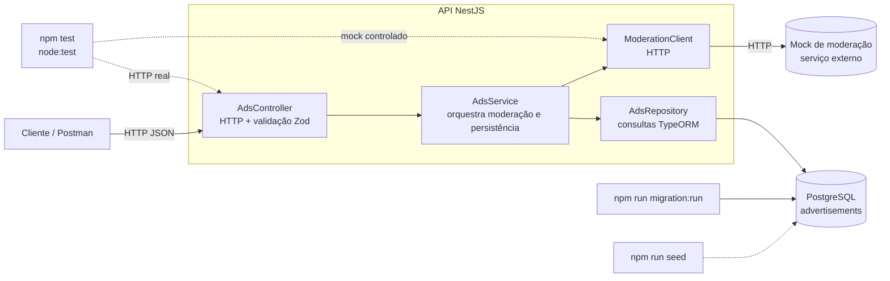

# Code Challenge — Grupo OLX

API REST para criar e consultar anúncios de marketplace. O serviço usa NestJS, PostgreSQL 16 e a API de moderação fornecida pelo desafio.

[Enunciado de backend](backend/README.md) · [Contrato do mock](backend/api-mock/docs-candidato/API.md) · [Decisões técnicas](DECISIONS.md) · [Uso de IA](AI_USAGE.md) · [Testes](test/README.md)

## Arquitetura

Um único deployable NestJS, com o mock de moderação tratado como serviço externo:



- **Controller + Zod:** borda HTTP, contrato de entrada e erros 400.
- **Service:** orquestra moderação, conversão de centavos, regras e resposta.
- **Repository:** única camada que conhece as consultas e o TypeORM.
- **ModerationClient:** única camada que conhece o contrato do mock.
- **Migrations/seed:** etapas explícitas de schema e dados, separadas do boot.
- **Testes:** exercitam a borda HTTP contra Postgres real e um mock controlado.

## Executar a API

Na raiz do projeto, com Node 24 e Docker Compose, execute:

```sh
npm ci
docker compose up -d --wait postgres
docker compose -f backend/api-mock/docker-compose.yml up -d --wait
npm run migration:run
npm start
```

Mantenha o terminal aberto. **O Nest não aplica migrations ao iniciar**: rode `npm run migration:run` antes de subir a API ou depois de atualizar o código. [GET /health](http://localhost:3000/health) retorna HTTP 200 com `{"status":"ok"}`. Para desenvolver com reinício automático, use `npm run start:dev` no lugar de `npm start`. Se a porta 3000 estiver ocupada, defina `$env:PORT = '3001'` no PowerShell e use essa porta nas chamadas abaixo. Se a política do PowerShell bloquear `npm.ps1`, use `npm.cmd`.

As migrations ficam em [`src/infra/db/migrations`](src/infra/db/migrations) e são aplicadas em uma etapa explícita, como em um deploy real. Isso evita que duas réplicas subindo ao mesmo tempo disputem a migration na inicialização. Os testes continuam aplicando migrations no banco de teste, porque o helper passa `runMigrations: true` para o `createApp`.

Para personalizar o ambiente, copie [`.env.example`](.env.example) para `.env` na raiz (PowerShell: `Copy-Item .env.example .env`). O arquivo local está no `.gitignore`. A API e o seed carregam o arquivo opcional ao iniciar, usando o suporte nativo do Node 24. Variáveis já exportadas no terminal têm prioridade. Reinicie a aplicação após editar o arquivo. O exemplo contém a porta da API, as URLs locais e os tempos da moderação.

O banco de desenvolvimento é `anuncios` na porta 5432, com volume persistente. A variável `DATABASE_URL` configura a conexão. A moderação usa `MODERATION_URL`, com padrão `http://localhost:8787`.

## Executar os testes

Com as dependências instaladas, rode na raiz:

```sh
docker compose up -d --wait postgres-test
npm test
```

A suíte compila a aplicação, abre a API e a moderação controlada em portas livres e usa exclusivamente o banco dedicado `anuncios_test` na porta 5433.

## Criar e consultar um anúncio aprovado

Em outro terminal PowerShell:

```powershell
$body = @{
  title = 'Bicicleta urbana'
  description = 'Bicicleta usada em bom estado.'
  price = 800.25
  category = 'esportes'
  images = @('https://example.org/bicicleta.jpg')
} | ConvertTo-Json
$ad = Invoke-RestMethod http://localhost:3000/ads -Method Post -ContentType application/json -Body $body
Invoke-RestMethod "http://localhost:3000/ads/$($ad.id)"
```

O cliente envia `price` em reais, como número JSON. No exemplo, `800.25` representa R$ 800,25 e é enviado nesse formato também à moderação. Desde a T-005, o banco guarda `priceCents` inteiro — `80025` — para evitar erros de ponto flutuante nos cálculos; a API continua recebendo e devolvendo `800.25` em reais. A conversão usa a representação decimal, sem multiplicar o `number` por 100.

Com aprovação da moderação, `POST /ads` retorna 201 e `Location: /ads/{id}`. `GET /ads/{id}` retorna 200 com o mesmo objeto:

```json
{
  "id": "692d0134-3e35-4158-b40d-4cffab8582e6",
  "title": "Bicicleta urbana",
  "description": "Bicicleta usada em bom estado.",
  "price": 800.25,
  "category": "esportes",
  "images": ["https://example.org/bicicleta.jpg"],
  "status": "approved",
  "rejectionReason": null,
  "createdAt": "2026-11-23T17:40:30.177Z"
}
```

Um UUID inexistente retorna 404 e um ID malformado retorna 400. A suíte chama a moderação por HTTP contra um servidor controlado, reinicia o Nest e recupera o anúncio usando a mesma base. O teste de criação remove o anúncio que criou.

As T-002 a T-007 cobrem criação, validação, aprovação, reprovação, listagem e falhas do serviço externo. Falhas do mock não gravam anúncio: 429/5xx/timeout viram 503 após duas tentativas; 400 ou resposta desconhecida viram 502.

## Validação de entrada (T-003)

`POST /ads` valida o corpo antes de chamar a moderação. As regras são:

- `title`: string, com espaços nas pontas removidos, entre 10 e 100 caracteres; o banco recebe o título já trimado;
- `description`: string não vazia;
- `price`: número JSON finito, maior que zero, com até 2 casas decimais e valor máximo de R$ 90.071.992.547.409,90;
- `category`: uma das categorias do mock (`eletronicos`, `moveis`, `veiculos`, `imoveis`, `esportes`, `colecionaveis`); as faixas de preço continuam sendo responsabilidade da moderação;
- `images`: lista com ao menos uma string não vazia.

Campos desconhecidos são ignorados. Payload inválido retorna 400 com os campos problemáticos e **não** chama a moderação nem grava anúncio:

```json
{
  "statusCode": 400,
  "error": "Bad Request",
  "message": "Dados inválidos.",
  "details": [
    { "field": "title", "message": "O título deve ter entre 10 e 100 caracteres." }
  ]
}
```

O teste `test/validation.test.cjs` cobre título, descrição, preço, categoria e imagens, além dos limites de 10 e 100 caracteres.

## Reprovação (T-004)

Quando a moderação responde 200 com `{"status":"rejected","reason":"price_out_of_range"}` ou outra reprovação com motivo, o anúncio também é gravado, mas com `status: "rejected"` e o motivo em `rejectionReason`. O `POST /ads` continua retornando 201 com `Location: /ads/{id}`, e o `GET /ads/{id}` devolve o mesmo recurso. Exemplo:

```json
{
  "id": "2e1a027a-3e80-4763-b31d-ef9341941446",
  "title": "Bicicleta com whatsapp",
  "description": "Fale comigo no whatsapp.",
  "price": 800.25,
  "category": "esportes",
  "images": ["https://example.org/bicicleta.jpg"],
  "status": "rejected",
  "rejectionReason": "contact_info_not_allowed",
  "createdAt": "2026-11-23T19:54:45.436Z"
}
```

O mock real devolve o motivo em `rejection_reason`; o `API.md` do mock documenta `reason`. O cliente aceita as duas chaves e expõe o valor como `rejectionReason`. A migration `AddRejectedStatus1795536000000` amplia o `CHECK` da coluna `status` para aceitar `approved` e `rejected`; a migration inicial não foi editada. A listagem padrão continua sendo o catálogo público de aprovados; a partir da T-013, `GET /ads?status=rejected` permite consultar os reprovados com o motivo.

## Preço em centavos (T-005)

`price` continua sendo um número em reais na entrada e na saída. O banco guarda os centavos na coluna `priceCents bigint`: `800.25` vira `80025`, `0.1` vira `10` e `1` vira `100`. A migration `AddPriceCents1795622400000` adiciona a coluna, faz o backfill das linhas existentes, cria o `CHECK ("priceCents" > 0)` e remove a coluna `numeric` antiga. Ela recusa dados legados com mais de 2 casas decimais em vez de arredondar silenciosamente.

A migration `WidenPriceCents1795795200000` ampliou a coluna de centavos para `bigint`. A API aceita até R$ 90.071.992.547.409,90, limite representável na entrada JSON dentro da precisão segura em centavos. Valores maiores retornam 400 antes da moderação. Por exemplo, um anúncio de esportes por R$ 21.474.836,48 retorna 201 com `status: "rejected"` e `rejectionReason: "price_out_of_range"` quando a moderação o reprova por preço.

A resposta HTTP não expõe `priceCents`: o mapper `toAdResponse` devolve `price` em reais. A conversão de entrada usa a string decimal (`"800.25"` → `80025`), sem `price * 100` em ponto flutuante. Preço com mais de 2 casas continua retornando 400.

## Listagem (T-006)

`GET /ads` lista anúncios com paginação e filtros opcionais por categoria e status:

| Parâmetro | Padrão | Regra |
|---|---|---|
| `page` | `1` | inteiro ≥ 1; 1-based |
| `pageSize` | `20` | inteiro entre 1 e 100 |
| `category` | — | opcional; uma das seis categorias do mock |
| `status` | `approved` | `approved` ou `rejected`; sem `all` |

A ordem é `createdAt DESC, id DESC`, para que a paginação seja determinística. Parâmetro ausente usa o padrão; valor vazio (`?page=`, `?category=`, `?status=`) é inválido e retorna 400. A resposta tem `data`, `page`, `pageSize`, `total` e `totalPages`; sem resultados, `total` e `totalPages` são 0:

Exemplo para `GET /ads?page=1&pageSize=1&category=esportes` com os dados do teste de listagem.

```json
{
  "data": [
    {
      "id": "00000000-0000-4000-8000-000000000005",
      "title": "Anuncio empatado mais novo",
      "description": "Descrição do anúncio de teste.",
      "price": 250,
      "category": "esportes",
      "images": ["https://example.org/teste.jpg"],
      "status": "approved",
      "rejectionReason": null,
      "createdAt": "2026-01-02T10:00:00.000Z"
    }
  ],
  "page": 1,
  "pageSize": 1,
  "total": 3,
  "totalPages": 3
}
```

Query inválida retorna 400 com `details`. Uma página além do fim retorna 200 com `data: []`. O acesso ao banco fica em `AdsRepository`; o serviço coordena paginação, mapper e resposta.

### Filtro por status (T-013)

Sem `status`, a listagem é o catálogo público de `approved`. Para consultar reprovados:

```http
GET /ads?status=rejected&page=1&pageSize=20
```

O filtro aceita `approved` ou `rejected`; qualquer outro valor retorna 400. A resposta de reprovados inclui `rejectionReason`. **Sem autenticação**, essa é uma visão de moderação/demonstração: em produção, listar reprovados e motivos deveria exigir autorização, porque o motivo pode expor informação operacional. O detalhe `GET /ads/{id}` continua acessível como antes.

A migration `AddListingIndexes1795708800000` criou índices parciais para `approved`; a T-013 os substitui por índices não parciais com `status` como primeira coluna (`ReplaceListingIndexes1795881600000`), para servir tanto `approved` quanto `rejected`. Com 57 anúncios o planner pode preferir `Seq Scan`; os índices existem para volume maior e foram validados com o plano forçado, não como uma promessa de ganho no seed.

## Falhas do mock (T-007)

O `POST /ads` aguarda a moderação, mas não transforma falha técnica em 500 genérico:

| Situação | Comportamento |
|---|---|
| `200 approved` | persiste aprovado e retorna 201 |
| `200 rejected` com motivo preenchido | persiste reprovado com motivo e retorna 201 |
| `429`, `5xx`, timeout ou erro de rede | tenta de novo uma vez; respeita `Retry-After` (teto de 1 s) no 429; depois de duas tentativas retorna **503** com `Retry-After: 1` e **não grava** |
| `400`, `200` com status desconhecido ou `rejected` sem motivo textual preenchido | **502**, sem retry e sem gravar |

O timeout por tentativa é 3 s e o backoff padrão é 200 ms. No ambiente local, `MODERATION_TIMEOUT_MS` e `MODERATION_RETRY_BACKOFF_MS` configuram esses valores. Os testes passam tempos menores diretamente à instância da API. O pior caso é de aproximadamente 6–7 s; o caminho normal continua dominado pela latência do mock (100–2000 ms).

### Testando 400 e 429 no Postman

A collection [`postman/anuncios.postman_collection.json`](postman/anuncios.postman_collection.json) tem chamadas diretas ao mock e à API. Para os erros do mock, use o mock com `ERROR_RATE=0`, senão o erro aleatório de 20% pode devolver 500 antes do 400:

```sh
docker compose -f backend/api-mock/docker-compose.yml down
docker compose -f backend/api-mock/docker-compose.yml run -d --service-ports -e ERROR_RATE=0 moderation-api
```

- **400 no mock:** `Mock fornecido > Recusar payload inválido no mock` envia um body sem `title` e espera `400 validation_error`. `Recusar JSON inválido no mock` espera `400 invalid_json`.
- **429 no mock:** `Forçar 429 no mock` envia `x-mock-force: rate-limit` e espera `429` com `Retry-After: 1`. Esse header é um gancho de teste do `server.js`, não faz parte do contrato público.

O header **não é repassado** pela nossa API: o Postman chama o Nest, e o `ModerationClient` monta a requisição externa com os campos do contrato, sem headers arbitrários. Para testar o comportamento do **app** com 429 real, suba o mock com o limite zerado e chame `POST /ads` pelo Postman:

```sh
docker compose -f backend/api-mock/docker-compose.yml down
docker compose -f backend/api-mock/docker-compose.yml run -d --service-ports \
  -e ERROR_RATE=0 -e RATE_LIMIT_RPS=0 moderation-api
```

O app tenta duas vezes, recebe 429 nas duas e responde **503** com `Retry-After: 1`, sem gravar anúncio. Para 500, use `ERROR_RATE=1`; para timeout, use latência acima de 3 s. Um 400 real do mock não ocorre no fluxo normal porque a validação Zod barra o payload antes; se acontecer, é divergência de contrato e o app responde **502**. Esse mapeamento é coberto por [`test/moderation.test.cjs`](test/moderation.test.cjs) com servidor controlado.

## Seed de demonstração (T-009)

Com o banco de desenvolvimento vazio e as migrations aplicadas. Atenção: `npm test` usa o banco de **teste** (`anuncios_test`, 5433) e **não** migra o banco de desenvolvimento (`anuncios`, 5432). Prepare assim:

```sh
docker compose up -d --wait postgres
npm run migration:run
npm run seed
```

O seed não aplica migrations sozinho; a API também não.

O script lê [`backend/api-mock/seed/ads.json`](backend/api-mock/seed/ads.json) — o arquivo fornecido, que não é alterado — e insere os **57 anúncios** como `approved`, com UUID, `priceCents`, `createdAt` original e uma imagem placeholder estável no Picsum (`https://picsum.photos/seed/anuncio-{id}/640/480`). O seed fornecido não tem imagens; o placeholder é só para a demonstração da listagem.

O script **só roda em base vazia**. Se já existir qualquer anúncio, ele para com mensagem de erro em vez de duplicar. Não passa os 57 anúncios pela moderação: isso faria 57 chamadas, sofreria com o erro aleatório/limite de 5 req/s e não é o objetivo do seed.

---

# Orientações originais do Grupo OLX

Olá! Que bom ter você por aqui.

## Propósito

Queremos entender como você pensa para resolver problemas, como organiza seu código, como toma decisões técnicas e como usa as ferramentas que tem à disposição, inclusive IA.

Não buscamos a solução perfeita. Buscamos uma solução que você entende, sabe justificar e saberia evoluir.

## O desafio

Escolha a trilha correspondente à vaga e siga as instruções do respectivo README:

- [Backend](./backend/README.md)

## Sobre o uso de IA

O uso de IA não só está autorizado como é encorajado e faz parte da avaliação. Ferramentas gratuitas são suficientes (ChatGPT, Claude, Gemini e Copilot têm planos gratuitos).

Avaliamos o seu senso crítico e o seu entendimento do resultado, não o plano que você assina. Você é responsável por cada linha entregue, tenha sido escrita por você ou por uma IA.

## Como desenvolver

1. Crie um repositório privado novo com o conteúdo deste repositório. Não use fork: forks de repositório público são sempre públicos.
2. Faça commits incrementais ao longo do desenvolvimento. O histórico nos ajuda a entender a evolução do seu raciocínio.

## Entrega

- **Prazo:** 7 dias corridos a partir do recebimento. Se precisar de mais tempo, avise o recrutador antes do fim do prazo.
- **Esforço esperado:** 4 a 6 horas de trabalho no total, não por dia. O prazo é longo de propósito, para caber na sua rotina.
- Ao finalizar, adicione como colaboradores os avaliadores indicados no e-mail do recrutador.
- Avise o recrutador por e-mail quando terminar.
- Vale o conteúdo do repositório no momento do envio do e-mail: **commits posteriores não serão considerados**.

## Apresentação

Depois da entrega, agendamos uma conversa com os avaliadores, numa janela de até 1h30 que pode terminar antes sem nenhum prejuízo:

- você apresenta a solução e as principais decisões;
- conversamos sobre trade-offs, alternativas e o uso de IA;
- podemos pedir uma pequena alteração ou evolução do código ao vivo.

## Dúvidas

Qualquer dúvida sobre o enunciado, fale com o time de Atração.

Bom código! ;)
