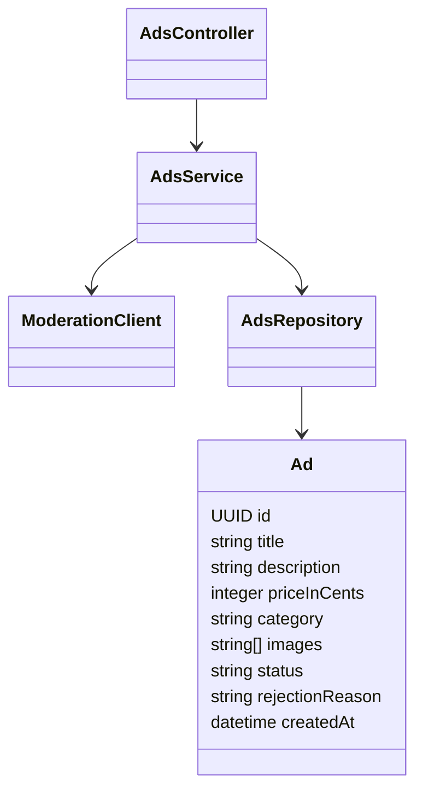

# Anúncios — design proposto

## Estrutura mínima

Um módulo NestJS recebe requisições HTTP. Um pipe aplica o schema Zod à entrada e devolve 400 para dados inválidos. O serviço recebe o tipo inferido do schema, chama a moderação por HTTP e persiste a decisão no Postgres via TypeORM.

O schema verifica o comprimento do título, o preço positivo e a presença de pelo menos uma imagem. Um preço positivo segue para moderação mesmo quando está fora da faixa da categoria. O serviço externo decide essa reprovação e informa o motivo.

Uma entidade Ad basta inicialmente. Images pode ser uma coluna JSON no Postgres; não há necessidade atual de entidades Categoria, Imagem ou Moderacao. Status é approved ou rejected; rejectionReason é nulo para approved e obrigatório para rejected. IDs e datas são gerados pela aplicação/banco, nunca aceitos como decisão do cliente.

## Fluxo confirmado

Validar entrada → chamar moderação → validar resposta externa → persistir anúncio com decisão → responder 201. A chamada externa fica fora da transação do banco. Uma falha da dependência interrompe o fluxo antes da gravação. Uma falha de persistência nunca retorna sucesso.

O cliente externo envia somente title, description, price e category para POST /v1/moderation/check. Reprovação é resultado de negócio; timeout, erro HTTP e resposta inválida são falhas técnicas. O mock não será importado pela aplicação.

## Contrato REST proposto

### Falhas da moderação

O cliente HTTP lança subclasses de `BaseError`, cada uma em seu arquivo dentro de `errors/`. A base estende `Error` e oferece uma mensagem, um `code` estável e `cause` opcional. Um filtro do NestJS traduz essas falhas para o contrato público. A causa interna fica disponível para diagnóstico.

| Erro | Exemplo | Resposta da API |
| --- | --- | --- |
| ModerationTimeoutError | Prazo da chamada expirou | 504 |
| ModerationUnavailableError | Mock responde 429 | 503, com Retry-After quando válido |
| ModerationProtocolError | Mock responde 200 com JSON sem status | 502 |

O pipe Zod responde por entradas inválidas (400). O detalhe pode usar NotFoundException para um anúncio inexistente (404). Uma decisão rejected segue o fluxo de persistência com motivo e retorna 201.

### Endpoints

POST /ads recebe title, description, price (reais), category e images. Retorna 201 com Location: /ads/{id}, campos recebidos, id, status, rejectionReason e createdAt (UTC). GET /ads/{id} retorna o mesmo objeto, inclusive para rejected; inexistente retorna 404.

GET /ads?category=esportes&page=1&pageSize=20 retorna 200 com items, page, pageSize, total e totalPages. Items contêm objetos completos. Lista somente approved, decisão já confirmada; demais regras de paginação seguem as propostas em requirements.md.

Formato de erro proposto: {"error":{"code":"validation_error","message":"Dados inválidos.","details":[{"field":"title","message":"Deve ter entre 10 e 100 caracteres."}]}}. Details é opcional. Uma falha interna de persistência retorna 500.

## Alternativas e consequências

- Listar reprovados faria sentido em uma visão de gerenciamento; escolhemos catálogo de publicados. Cliente guarda o ID para acompanhar rejeição.
- Persistir pending exigiria processamento posterior e acompanhamento; usuário escolheu fluxo síncrono sem persistência em falhas.
- Reprovação com erro HTTP esconderia a distinção entre criação e publicação; usuário confirmou 201 com status explícito.
- Escolhemos Postgres pelas restrições de integridade e pela estrutura conhecida dos anúncios. Docker Compose facilita reproduzir o ambiente.
- Consideramos DTOs com class-validator. Escolhemos Zod pela experiência prévia do candidato com a biblioteca e pela possibilidade de inferir o tipo a partir do mesmo schema que valida o JSON.

## Verificação

Jest/Supertest propostos para observar HTTP da aplicação, com base isolada no mesmo banco escolhido para execução. Controlar resultados da moderação nos testes de comportamento. Testar separadamente o adaptador contra servidor HTTP controlado, incluindo timeout e 429, sem depender de aleatoriedade do mock. Rodar também aprovação e reprovação contra o mock real pelo contrato documentado.

Sem esquema existente da aplicação a migrar nesta etapa. Na implementação, criar migration inicial; evitar depender de sincronização automática do ORM para a entrega.
